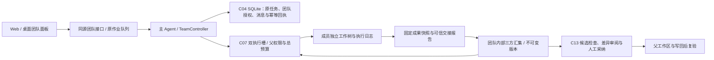

# C08 团队协作

## 目标与调研结论

本轮在已有 C04 任务、C06 单机队列、C07 隔离开发和 C13 成果采纳上完成持续协作闭环：同一团队的成员可以执行多个工作项、可靠通信，使用尚未采纳但已经固定的依赖成果，最后统一审阅和验收。一个会话只有一个团队，主 Agent 固定为负责人。

2026-11-04 调研的产品做法：

| 官方资料 | 可核对的做法 | 本项目采用方式 |
| --- | --- | --- |
| [Claude Code Agent Teams](https://code.claude.com/docs/en/agent-teams) | 负责人、成员、共享任务及消息；依赖与认领；官方仍提示实验性、恢复和收尾局限 | 保留这些协作职责；用同一个 SQLite 事务核验认领，不把成员消息当用户批准 |
| [Codex Subagents](https://learn.chatgpt.com/docs/agent-configuration/subagents) | 子执行拥有独立上下文，可以查看、引导、等待和停止，继承执行权限约束 | 继续复用 C07 的子执行、共享预算、双槽并发和审批接续 |
| [Codex Worktrees](https://learn.chatgpt.com/docs/environments/git-worktrees) | 通过工作树隔离代码和未提交成果，另行处理成果与目录生命周期 | 成员隔离修改；团队先汇集固定树，父目录仅通过 C13 人工采纳写入 |
| [Cursor Subagents](https://cursor.com/docs/subagents) | 独立上下文、前后台执行及接续；共享目录和隔离工作树是不同选择 | 持久成员身份与执行段分别建模；普通后续工作使用新基线和交接摘要，具体审批复用原工作树 |

这些是公开产品协议，不推测其内部源码。双成员交付样例只能证明本轮链路可运行，不证明普遍性能或成功率提升。

## 批准方案与结构

批准范围按四个内部阶段交付：团队身份和任务归属；消息、连续执行及转派；依赖成果和整体集成；停止、审批、重启与端到端验收。实现属于同一个完整功能迭代。

- `teams/models.py`：负责人和成员的有界工具输入。没有客户端可指定的发送者、工作树路径或预算提升入口。
- `teams/store.py`：团队、稳定成员、任务授权、消息和幂等操作，与 C04 共用数据库。这里记录的是工作项的协作授权和成果准备状态，业务范围、依赖和最终完成事实仍来自原任务清单。
- `teams/controller.py`：角色约束、认领、派发、消息安全边界、跨轮核对、汇集与停止。
- `teams/workspaces.py`：固定实际父目录作为起点，按来源基线逐项三方合并；每次发布生成新的快照编号，不覆盖旧证据。
- `web/teams.py` 和 `TeamPanel.tsx`：Web/桌面共用的团队查看、用户指示、停止及工作树回收入口。

## 执行与成果交接

1. 负责人先取得正式计划批准，建立团队和有明确文件范围的成员；规划与研究模式仍不能启动团队开发。
2. 使用 `task_create` 建立原 C04 工作项及完成条件，使用 `team_offer_task` 关联团队目标、范围和可选指定成员。
3. `team_dispatch` 在事务内选择空闲成员及可执行项。任务业务指纹、当前归属、成员写范围和依赖版本都必须有效。最多两个子执行同时运行，使用原 C07 预算预留和权限取交集规则。
4. 每段实际执行固定 `team_id`、`team_member_id`、任务编号和子日志父归属。成员只获得 `team_get`、`team_send_message` 及获准的开发工具，没有管理团队、递归委派、自批或修改任务清单的能力。
5. `wait_subagents` 等待真实执行完成。只有报告有效、快照完整、没有越界且范围仍有效时，成果才能进入内部汇集。
6. 下游从明确固定的团队成果建立独立工作树，记录使用的上游执行编号；不要求先把未采纳上游标成 C04 已完成。
7. 汇集以团队初始树为共同事实源，逐项按各自实际基线三方合并。冲突明确记录并阻止最终采纳，不随意选一方覆盖。负责人可在安全收拢后重新分配冲突项，在当前固定基线上解决。
8. 全部团队授权项有效就绪才设置 `stage_ready`。它表示整体成果可审阅，不代表检查通过或任务最终完成。人工准备候选、检查、确认写回以及父目录复验仍分别记录。

团队成员成果必须整体采纳，不能从单个成员入口绕过依赖关系。采纳记录另存组成成果编号，用于原 C04 工作项核对是否已经采纳；不会自动将工作项标成完成。

成员后续工作保留身份、交接摘要和累计用量，使用新的固定基线和独立工作树。具体动作审批接续则复用原工作树、原动作及累计预算，不重复执行已经成功的工具。

本机长任务迭代增加了明确的安全暂停接续：先收拢成员及命令，固定父级和各成员剩余预算，再恢复同一成员、原任务及工作树的可信历史。暂停前未执行的旧调用保持未执行，新段重新决策；子审批仍使用原审批链。任意旧进程现场恢复不在范围内，详见[长任务协议](LONG_RUNNING.md)。

普通 C07 委派及直接重开任务不能绕过团队持有中的认领。正在执行、等待审批或进程未核对的工作项必须先安全收拢，才能改范围或转派。修改上游条件或重新分配上游成果会使下游待复核。

## 消息与权限

- 消息先持久化，再返回成功；相同请求编号和内容重试不重复追加，换正文或改变是否续轮的意图会被拒绝。
- 发送者由宿主绑定为用户、负责人或当前成员；收件人必须属于同团队。
- 消息作为有来源的协作数据，在模型/工具批次之间交付。只有实际模型请求成功才推进持久游标；请求失败或中断可在新段重送。
- 消息不提供用户批准，不修改目录授权，也不能自动重放未知操作。
- 空闲成员不循环请求模型。前端“发送指示”只落盘；“发送并继续”才显式通过原作业队列请求负责人续轮。活动时不会再开一个并发负责人。
- 模型启动只注入团队索引，完整目标由 `team_get` 回读；历史消息按游标投递，避免每个新段都重复注入全部消息正文。未建立团队时仅展开创建工具，减少普通任务的固定输入成本。

当前最多 8 名成员、100 个授权工作项、1000 条消息；单轮最多 8 段 C07 委派。输入、工具、请求及时间仍受原运行预算限制，达到上限明确停止，不悄悄放宽。

## 跨段证据、停止和重启

开发交接的来源核验覆盖当前段及宿主绑定的审批接续链。每一段都必须是同一成员、任务、角色和工作树，具有可信结束与安全清理记录；链有上限且禁止循环。报告保存实际证据的 `run_id`。不同段复用同名调用编号时，不能以有歧义的编号支撑结论。负责人、其他成员或任意历史运行都不能提供替代证据。

停止先冻结团队授权，等待成员、命令清理及固定证据完成，最后才发布停止状态。主循环在安全边界等停止完成后以 `team_stopped` 收尾，不再循环请求模型或转派。停止团队不自动删除工作树；停止后的新一轮仍可处理会话内其他工作，旧团队仅供核对。

重启只读取持久事实，不恢复未知协程或重放原请求。旧认领缺可信结束时进入待核对，阻止重复执行。只有用户核对原进程和工作区、满足原会话可接续条件后，才能明确释放并重新分配；未知清理、目录归属或不完整快照继续保留现场。

用户在团队停止并确认安全后，可明确丢弃团队汇集和成员工作树，固定补丁、执行、消息和采纳历史保留。每个准备中的工作树编号也先登记，失败不会变成无法核对的匿名目录。彻底删除会话时，团队工作树必须先明确处理；团队状态、消息、幂等记录和固定元数据随受保护的清单一起清理。

## 前端与验收

会话工作栏以稳定成员数显示“团队”。Agent 详情页展示成员、文件范围、累计用量、各段日志、原工作项及依赖版本、消息、审批来源和汇集成果。历史只展示当轮固定快照；归档和历史不提供管理操作。成员用量已包含在父运行总数中，不再次相加。

验收覆盖：

- 双成员读到实际未采纳依赖源码；同成员跨工作项保留身份和摘要。
- 真实线程争抢认领时不重复；范围不足、任务条件变化、旧段未知和普通委派绕过均拒绝。
- 消息幂等、来源核验、成功请求后确认游标；空闲没有额外模型请求。
- 具体动作批准/拒绝、跨段证据、累计预算、原事件字节不变。
- 真实双槽修改同文件产生显式冲突；未汇集成果不写入父目录。
- 停止等待真实收尾、明确回收、重启只核对以及会话物理清理。
- 候选检查、人工采纳、父目录复验、原 Git 索引保留；Web/桌面共用接口和窄屏页面。

真实模型样例保存在 `.runtime/c08-live`。原计划运行、多个审批段及一次报告证据失败均原样保留；修复后在同一团队明确重新分配，最终运行 `0ccb5681-f19c-4213-a88c-f1fa7acbd30d` 的两名成员都实际交付并形成固定成果。其采纳前父目录检查失败不改写；采纳记录 `35f41c04-9d91-4fc1-822e-bb06065ec931` 的候选与目标检查均通过，Git 索引保持。该样例包含人工指示和失败后继续，不能描述为一次无人介入成功或普遍稳定性提升。

本轮不包含 Windows 操作系统命令/网络沙箱、通用后台命令、分布式协作或多供应商路由。命令仍是需独立授权的本机进程；Git 工作树只提供代码隔离。

### 本轮验收记录

- 受影响后端回归：329 通过、5 项 Windows 平台限制跳过，报告 `.runtime/c08-final.xml`。覆盖工作项、会话、权限、上下文、执行、子 Agent 和集成；没有放宽生产预算。
- 最后补充的团队上下文、取消/父分组约束、停止幂等、历史只读补丁及清理专项：39 通过、1 项平台限制跳过，报告 `.runtime/c08-latest.xml`。原条件重新打开与任务联动追加专项 15 项通过，报告 `.runtime/c08-task-final.xml`。
- 前端全量 200 项通过，报告 `.runtime/c08-frontend.json`；新增稳定成员入口与跨段来源等最终相关专项 27 项通过。类型检查和最终生产构建通过，构建仍有既有大包提示。
- 真实双成员成果的候选检查、人工采纳与父目录复验均通过，事实摘要 `.runtime/c08-live/integration.json`。源运行采纳前的失败检查仍保留；不是把历史状态改成通过。
- 实际浏览器完成团队查看、指示落盘、候选检查、人工写回和父目录复验；样例父运行 `245eff84-dcb5-476e-bfcd-f8b51ba20b8f`，采纳记录 `6977d157-bad0-45c6-95e0-797dcc57a796`。截图 `output/playwright/c08-desktop.png`、`output/playwright/c08-mobile.png`；390px视口和抽屉的 clientWidth/scrollWidth 均为390px，团队内容为343px/343px，控制台0错误。

这些报告保存在本机验收目录，原有未提交的审批界面改动已单独备份核对；本轮没有自行暂存、提交或推送。
